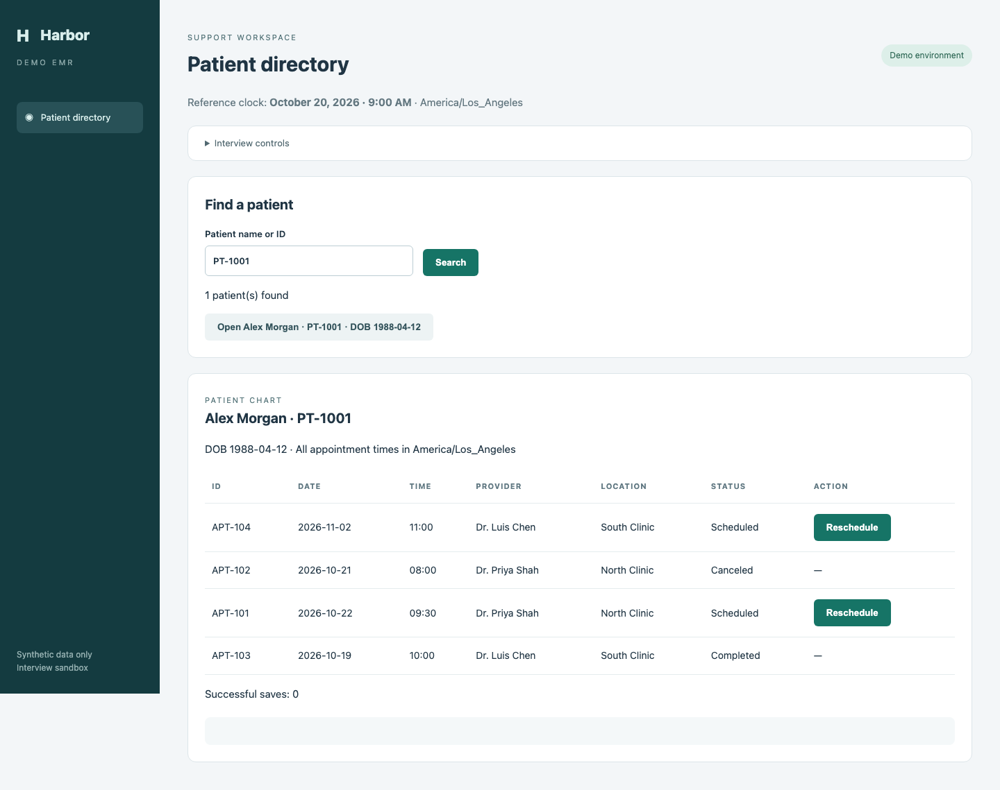

# Support engineer automation interview

A standalone, local interview exercise with a fictional **Harbor Demo EMR** and Playwright/TypeScript scaffolding. No accounts, credentials, databases, or production systems are needed. All patient records are invented.



## Get started

Install Node.js 20 or newer. Fork this repository, clone your fork, then run from its root:

```sh
npm ci
npx playwright install chromium
npm start
```

Open http://127.0.0.1:4173. On Linux, browser system dependencies may require `npx playwright install --with-deps chromium`.

In a second terminal:

```sh
npm test                  # Demo health checks; should pass before you start
npm run test:challenge    # Acceptance tests; intentionally fail until you implement the TODOs
npm run typecheck
```

Playwright starts the demo automatically if it isn't already running. `npm run test:headed` runs demo health checks in a visible browser; `npm run report` opens the HTML report. Failed tests retain screenshots and traces. To run your challenge visibly: `npm run test:challenge -- --headed`.

## Your work

Implement the two functions in `candidate/automation.ts`. You may add helper files and tests. Use the browser UI: do not read or write localStorage, import the demo's data, or use internal app state to solve the challenge. Playwright locators, DOM text/attributes, and UI interactions are allowed. Avoid fixed sleeps and arbitrary retry loops. Do not change the demo or supplied acceptance tests to make your solution pass.

Functions receive a page already opened to the demo, possibly with a different chart open. They must navigate to the requested patient themselves. The browser context is preserved between repeated calls in a test.

### Part 1 — Easy (20–25 minutes)

Find a patient by exact ID, then return the earliest upcoming appointment whose status is `Scheduled`. Return `patient_not_found` or `no_upcoming_appointments` when appropriate. Include appointment ID, date, time, provider, and location in a successful result.

Use the fixed reference instant **October 20, 2026 at 09:00 in America/Los_Angeles** (`2026-10-20T09:00:00-07:00`), rather than your computer's current date. An upcoming appointment starts strictly after that instant. Dates and times in the UI are local to this clinic. The records are deliberately unsorted.

Try `PT-1001`, `PT-1002`, `PT-1003`, and a missing ID. Two patients share the name Alex Morgan. Add at least one meaningful test of your own.

### Part 2 — Medium-hard (45–60 minutes)

Reschedule **APT-101** for **PT-1001** to **2026-10-23 at 14:00, Dr. Priya Shah, North Clinic**. Your function accepts the request as parameters; don't hardcode this patient or appointment in the implementation.

Verify the exact patient and appointment before editing. Match all four slot fields. If the appointment already matches, return `already_matches` without another save. If the requested slot is unavailable, return `slot_unavailable` without substituting another slot. For a missing patient/appointment or an explicit unsuccessful save, return `failed` with an explanation.

After saving, reload or reopen the chart and verify the persisted details. A toast alone is insufficient. If a save's outcome is uncertain, inspect current state before retrying. Bound any retry logic. If verification remains impossible, return `needs_review` rather than claiming success or blindly saving again. Return `rescheduled` only after verifying the requested change.

Use **Interview controls** to select deterministic failure scenarios. A scenario change resets all records; Reset demo restores the selected scenario. The `save_failed` and `unverifiable` failures persist until reset. `lost_confirmation` commits the change but displays an ambiguous connection error. `rerender` replaces appointment row elements on selection. `slot_taken` rejects the selected slot on save. `already_done` starts with the requested change already present.

Add diagnostic context for unexpected failures. The supplied Playwright configuration captures screenshots and traces automatically for failed tests; add your own evidence for handled failure outcomes where useful.

## How persistence works

This is a deliberately small static EMR simulation: saves persist in **localStorage in the current browser context**, including across page reloads. There is no backend or real network outage. Timing and failure modes are simulated in the UI. Each Playwright test gets an isolated context; reruns inside a test retain the same state. Closing a manually opened browser may retain its localStorage; Reset demo clears the scenario's records. This tests UI automation and state reconciliation, not database durability.

## Submission

Share your fork or a commit, plus a short note explaining your approach, test commands, retry policy, limitations, and anything unfinished. Keep generated reports and node_modules out of Git. Interviewer setup and evaluation notes are in `INTERVIEWER.md`.
